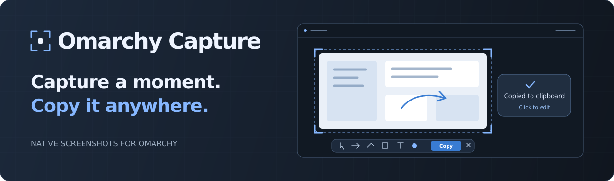
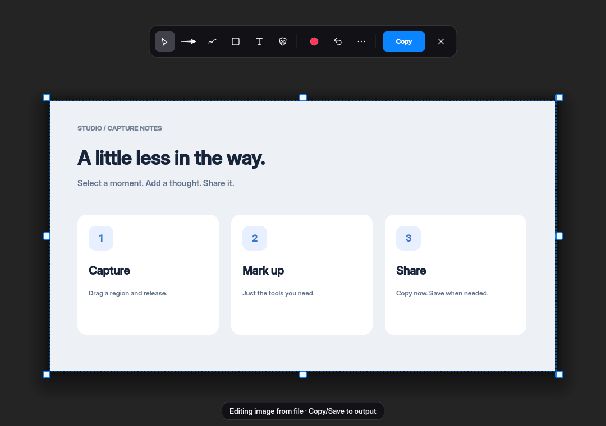
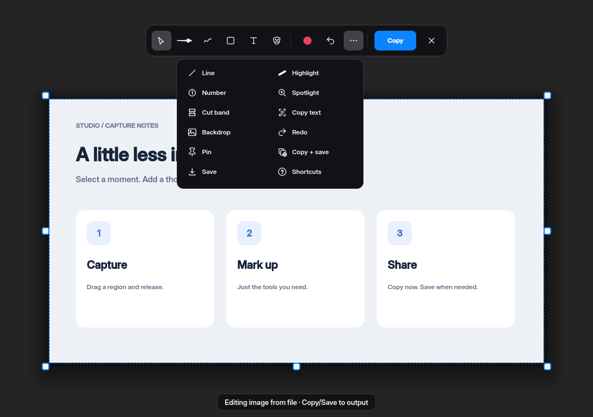

<p align="center">
  
</p>

<p align="center">
  <a href="https://omarchy.org"></a>
  <a href="https://hypr.land"></a>
  <a href="LICENSE"></a>
</p>

<p align="center">
  A compact screenshot and annotation app for Omarchy.<br />
  Capture, mark up, copy — save only when you choose.
</p>

<p align="center">
  <a href="#install">Install</a> ·
  <a href="#use">Use</a> ·
  <a href="#configure">Configure</a> ·
  <a href="#development">Development</a>
</p>

## See it in action



- **Copy first.** Captures go straight to the system clipboard. Save a file only when you need one.
- **Edit on demand.** A compact toolbar for arrows, drawing, shapes, text, and redaction. Extra tools live under **…**.
- **Save deliberately.** Use **Save** on the notification or **… → Save** in the editor. Copy from the editor stays silent.
- **Keep native pixels.** Region, window, fullscreen, and scrolling captures preserve detail on scaled displays.

Native **Wayland + Hyprland**. Follows your Omarchy theme, including live changes.

## Install

```sh
git clone https://github.com/hudrucan/omacap.git
cd omacap
./install-omarchy
```

The installer installs missing dependencies through Omarchy, builds in
`~/.cache/omacap/build`, and installs the app under `~/.local`.
Use `OMACAP_PREFIX` to choose another install prefix.

Omacap is a native app. Add its capture binding in `~/.config/hypr/bindings.lua`:

```lua
o.rebind("PRINT", "Screenshot", "omacap --notify")
```

This replaces the current Print binding. Reload and check with
`hyprctl reload` and `hyprctl configerrors`. Launch **Omacap** from the app launcher
or run `omacap --notify` to use it without a binding.

## Use

**Drag** an area, **click** a window, or click empty desktop space for the focused monitor.
With `--notify`, the copied image has **Edit** and **Save** actions.
Without it, a floating preview offers editing, copying, pinning, and file drag;
it fades after 7 seconds of idle time. Hovering pauses the countdown.

The editor's main action is **Copy**. Save lives under **… → Save**.
Press **?** or choose **… → Shortcuts** for keyboard help.

| Key | Action |
| :--- | :--- |
| Enter / Ctrl+C | Copy only |
| Ctrl+S / Ctrl+Shift+S | Save / Save As |
| V / A / F | Select or crop / arrow / draw |
| R / E | Rectangle / ellipse |
| T / D / O | Text / redact / OCR |
| Ctrl+Z / Ctrl+Shift+Z | Undo / redo |
| Ctrl+P | Pin on screen |
| W | Switch editor between overlay and window |
| ? | Toggle keyboard help |
| Esc | Dismiss a menu or close |

<details>
<summary><strong>More tools and output actions</strong></summary>



Line, highlighter, numbered markers, spotlight, cut band, OCR, backdrops, redo,
pinning, Copy + Save, and Save are available under **…**.

</details>

<details>
<summary><strong>Capture from the terminal</strong></summary>

```sh
omacap --capture-region --notify
omacap --capture-window --notify
omacap --capture-fullscreen --copy
omacap --scroll
omacap --editor window
omacap --file /path/to/image.png
omacap --clipboard
```

Use `--copy` or `--save` to output directly. Combine them to copy and save.
`omacap --help` lists the available modes and options.

</details>

## Configure

Defaults work out of the box. Optional settings live in
`~/.config/omacap/omacap.conf`.

<details>
<summary><strong>Output and editor presentation</strong></summary>

```ini
[output]
autosave = false
directory = ~/Pictures/Screenshots

[editor]
mode = overlay
```

These are the defaults. Set `mode = window` for a normal compositor window.
`OMACAP_SCREENSHOT_DIR` overrides the save directory.

</details>

<details>
<summary><strong>Temporary data</strong></summary>

Omacap keeps no screenshot history. Notification and preview actions use temporary
source images, edit logs, and thumbnails under `$XDG_RUNTIME_DIR/omacap/handoffs/`.
Documents older than 15 minutes are pruned when a new one is published.
Copy from the editor creates no additional handoff document.

</details>

<details>
<summary><strong>Update</strong></summary>

From your checkout:

```sh
git pull --ff-only
./install-omarchy
```

</details>

## Development

Built with **C++23 and Qt 6.8+**, LayerShellQt, Wayland, and libdeflate.
Runtime tools include `hyprctl`, `wl-copy`, and `wl-paste`; OCR uses `tesseract`.
See [dependencies](docs/dependencies.md) for the full list.

```sh
make build
make check
```

Checks build the app, run headless interaction tests, and run available static
analysis. Generated test screenshots stay in `build/smoke-output/`.

Omacap is a UI-focused fork of [Omasnap](https://github.com/omacom/omasnap),
starting at `6208946`. Original MIT copyright and bundled font/icon notices
are retained. See the [changelog](CHANGELOG.md) and [font notices](assets/FONTS.md).
The PNG metadata key `Omasnap logical size` is shared with upstream.

An optional [notification hover patch](patches/omarchy-notifications-hover.patch)
is included for a user-owned clone of Omarchy's notification plugin.

Found a bug? [Open an issue](https://github.com/hudrucan/omacap/issues) with your
Omarchy and Hyprland versions and steps to reproduce.

---

<p align="center">Made for <a href="https://omarchy.org">Omarchy</a> · <a href="LICENSE">MIT licensed</a></p>
